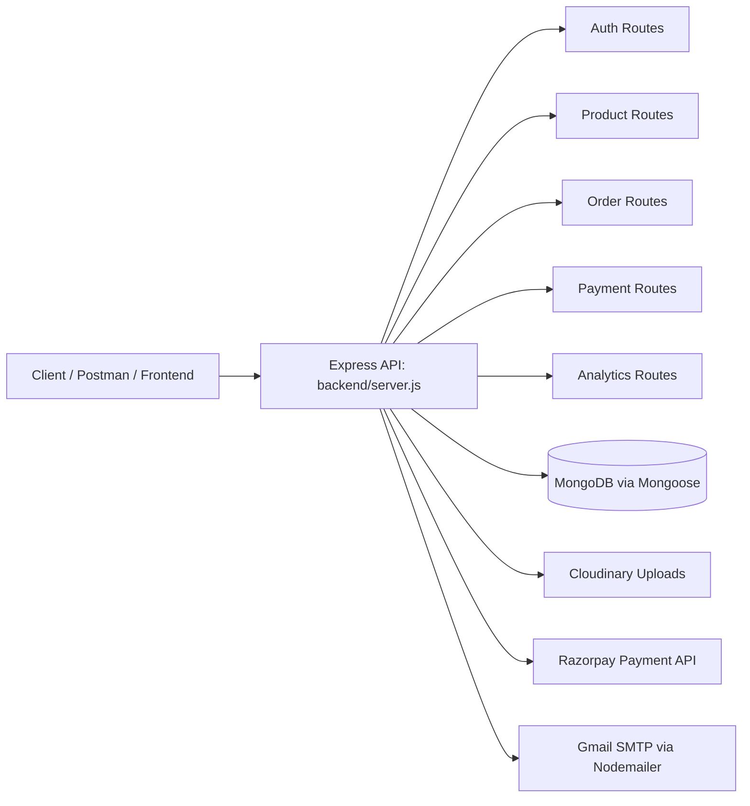

# ShopNest E-Commerce API

ShopNest is a MERN-style e-commerce project focused on a backend API for product management, user authentication, order processing, payment flow, and admin analytics. The repository includes a backend service built with Node.js and Express, plus a minimal frontend folder that currently acts as a Vite starter instead of a full storefront implementation.

> This repo is best understood as an API-first e-commerce starter. The core business logic and backend functionality are implemented in the `backend/` folder.

---

## 1. Project Overview

The application is structured around a simple commerce flow:

- Users can register and log in
- Admins can manage products and view analytics
- Customers can place orders and view their history
- Payments are initialized and verified through Razorpay
- Product images are uploaded to Cloudinary
- Email notifications are sent using Gmail SMTP via Nodemailer

The app uses MongoDB for persistence and Mongoose for schema modeling and validation.

---

## 2. Architecture

### High-level architecture



### Design pattern

- REST API driven by Express routers
- Controller-based business logic
- Middleware-based access control with JWT and admin checks
- MongoDB document model per domain entity
- Environment-based configuration for secrets and deployment

---

## 3. Technology Stack

### Backend
- Node.js
- Express.js
- MongoDB + Mongoose
- JWT for authentication
- bcryptjs for password hashing
- Multer for file uploads
- Cloudinary SDK for image hosting
- Razorpay SDK for payment integration
- Nodemailer for transactional email
- dotenv for environment variables
- CORS for cross-origin access

### Frontend
- A minimal Vite React starter exists under `frontend/`
- At the time of this repo snapshot, it is not a complete storefront application and does not contain the production e-commerce UI

---

## 4. Repository Structure

```text
shopnest-ecom-MERN-master/
├── backend/
│   ├── config/
│   │   ├── cloudinary.js        # Cloudinary config
│   │   └── db.js                # MongoDB connection
│   ├── controllers/
│   │   ├── analyticsController.js
│   │   ├── authController.js
│   │   ├── orderController.js
│   │   ├── paymentController.js
│   │   └── productController.js
│   ├── middleware/
│   │   ├── adminMiddleware.js    # checks admin role
│   │   └── authMiddleware.js     # validates JWT
│   ├── models/
│   │   ├── Order.js
│   │   ├── Product.js
│   │   ├── Review.js
│   │   └── User.js
│   ├── routes/
│   │   ├── analyticsRoutes.js
│   │   ├── authRoutes.js
│   │   ├── orderRoutes.js
│   │   ├── paymentRoutes.js
│   │   └── productRoutes.js
│   ├── utils/
│   │   └── sendEmail.js         # Gmail SMTP helper
│   ├── uploads/
│   ├── .env                     # local environment config
│   ├── package.json
│   ├── seed.js                  # sample admin + product data
│   └── server.js                # Express app bootstrap
│
├── frontend/
│   ├── README.md
│   └── node_modules/
│
├── ShopNest_Postman_Collection.json
├── package.json
├── README.md
├── .gitignore
└── package-lock.json
```

---

## 5. Core Domain Models

### User
Stored in `backend/models/User.js`

```js
{
  name: String,
  email: String,
  password: String,
  role: 'user' | 'admin',
  timestamps: true
}
```

### Product
Stored in `backend/models/Product.js`

```js
{
  name: String,
  description: String,
  price: Number,
  category: String,
  stock: Number,
  imageUrl: String,
  ratings: Number,
  numReviews: Number,
  timestamps: true
}
```

### Order
Stored in `backend/models/Order.js`

```js
{
  userId: ObjectId,
  items: [{ productId, qty, price }],
  totalAmount: Number,
  address: {
    fullName,
    street,
    city,
    postalCode,
    country
  },
  paymentId: String,
  status: 'Pending' | 'Shipped' | 'Delivered',
  timestamps: true
}
```

---

## 6. Middleware and Security

### JWT protection
`backend/middleware/authMiddleware.js`

- Reads Bearer token from the `Authorization` header
- Verifies it using `JWT_SECRET`
- Loads the matching user and attaches it to `req.user`
- Blocks unauthorized requests with `401`

### Admin restriction
`backend/middleware/adminMiddleware.js`

- Ensures the authenticated user has `role === 'admin'`
- Rejects non-admin users with `401`

---

## 7. API Endpoints

Base URL: `http://localhost:5000`

### Authentication

| Method | Route | Access | Description |
| --- | --- | --- | --- |
| POST | `/api/auth/register` | Public | Register a new user |
| POST | `/api/auth/login` | Public | Login and receive JWT |
| GET | `/api/auth/users` | Admin | Retrieve user list |

### Products

| Method | Route | Access | Description |
| --- | --- | --- | --- |
| GET | `/api/products` | Public | List all products |
| GET | `/api/products/:id` | Public | Get a single product |
| POST | `/api/products` | Admin | Create a product and upload image |
| PUT | `/api/products/:id` | Admin | Update product details |
| DELETE | `/api/products/:id` | Admin | Remove a product |

### Orders

| Method | Route | Access | Description |
| --- | --- | --- | --- |
| POST | `/api/orders` | Authenticated user | Create order |
| GET | `/api/orders/myorders` | Authenticated user | Fetch logged-in user's orders |
| GET | `/api/orders` | Admin | Fetch all orders |
| PUT | `/api/orders/:id/status` | Admin | Update order status |

### Payments

| Method | Route | Access | Description |
| --- | --- | --- | --- |
| POST | `/api/payment/order` | Public | Create Razorpay order payload |
| POST | `/api/payment/verify` | Public | Verify Razorpay signature |

### Analytics

| Method | Route | Access | Description |
| --- | --- | --- | --- |
| GET | `/api/analytics` | Admin | Returns total products, orders, users and revenue |

---

## 8. Environment Configuration

The project expects a `.env` file in `backend/`.

Example:

```env
PORT=5000
MONGO_URI=mongodb://127.0.0.1:27017/shopnest
JWT_SECRET=your_jwt_secret_key
CLOUDINARY_CLOUD_NAME=your_cloud_name
CLOUDINARY_API_KEY=your_api_key
CLOUDINARY_API_SECRET=your_api_secret
RAZORPAY_KEY_ID=your_razorpay_key_id
RAZORPAY_KEY_SECRET=your_razorpay_key_secret
GMAIL_USER=your_email@gmail.com
GMAIL_PASS=your_email_password
FRONTEND_URL=http://localhost:3000
NODE_ENV=development
```

### Required services
- MongoDB instance
- Cloudinary account
- Razorpay account
- Gmail account with app password for SMTP

---

## 9. Setup and Run Instructions

### Install root dependencies
```bash
npm install
```

### Install backend dependencies
```bash
cd backend
npm install
```

### Seed demo data
```bash
npm run seed
```

This script:
- wipes existing users/products
- creates an admin account
- inserts a few demo products

### Seed admin credentials

```text
Email: admin@shopnest.com
Password: password123
```

### Run the app
From the root project directory:

```bash
npm run dev
```

This is configured to launch the backend and frontend together using `concurrently`.

> Note: the current frontend folder is just a minimal template, so the app may not fully run as a complete storefront without additional client code.

### Start backend alone
```bash
cd backend
npm run dev
```

### Production-style start
```bash
cd backend
npm start
```

---

## 10. Email, Uploads, and Payments

### Email notifications
The app sends welcome and order confirmation emails through `backend/utils/sendEmail.js` using Nodemailer and Gmail SMTP.

### Product image uploads
Product creation and update routes accept a file upload via Multer, then upload the file to Cloudinary. The generated secure URL is stored in `imageUrl`.

### Payment flow
- `POST /api/payment/order` creates a Razorpay order
- `POST /api/payment/verify` verifies the payment signature
- The order is then saved in MongoDB with the payment reference

---

## 11. Current Repo Reality and Limitations

This checkout is a strong backend foundation, but it is not a fully complete end-to-end storefront implementation yet.

Current observations:
- The backend is implemented and wired with routes, controllers, schemas, auth, payments, and admin endpoints
- The frontend folder is a basic Vite starter rather than the full ShopNest UI
- Some sections of the original README suggest a richer frontend experience, but the actual project tree in this workspace does not include the full client application code

In other words, this repo is best treated as a backend-first MVP / e-commerce API starter.

---

## 12. Testing and Postman

A Postman collection is included at the root:

- `ShopNest_Postman_Collection.json`

This can be imported into Postman to manually test protected endpoints, authentication, orders, and admin routes.

---

## 13. Recommended Next Steps

1. Add a complete React/Vite storefront client
2. Wire frontend to the backend API
3. Add product reviews and cart state management
4. Add order pagination and search filters
5. Improve validation and error responses
6. Add automated tests for routes and controllers
7. Move secrets to deployment-managed environment variables

---

## 14. Summary

ShopNest is a practical full-stack e-commerce starter with a real Express + MongoDB backend, admin protections, JWT auth, product uploads, payments, and analytics. It is a good foundation for a production-ready e-commerce app, especially if paired with a complete frontend client in the next stage of development.
